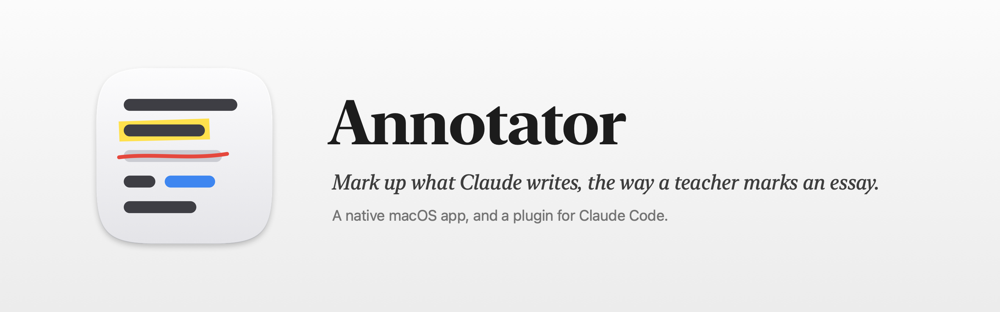
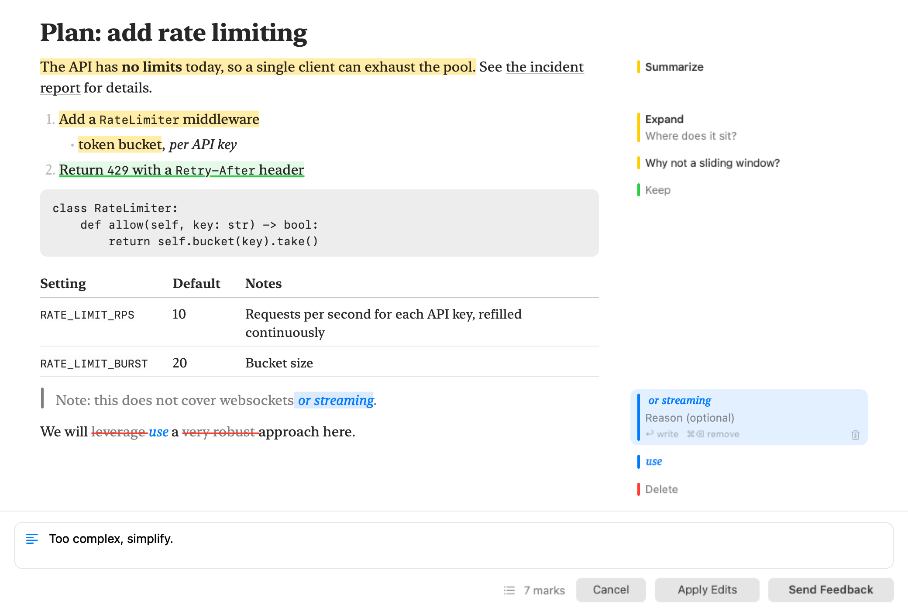
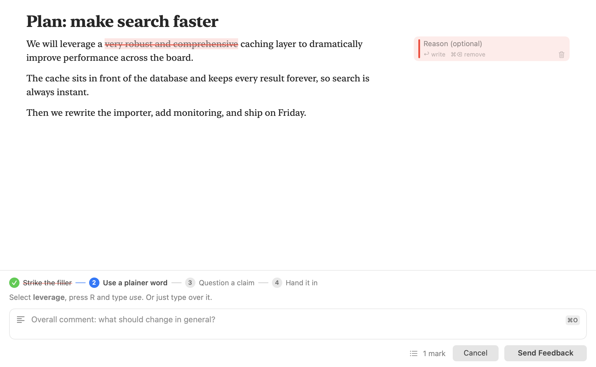
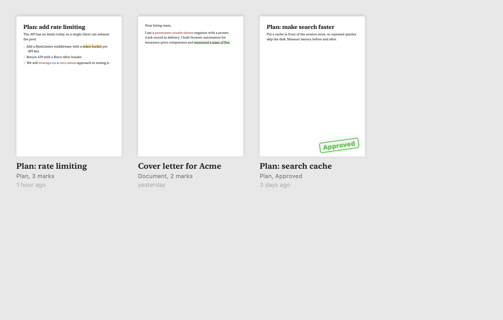
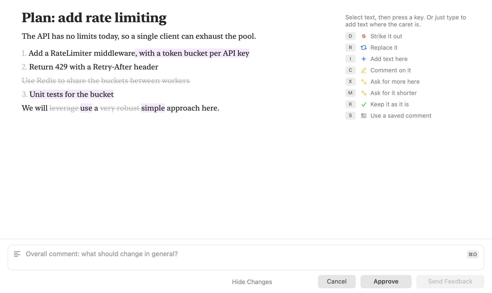

# Annotator



A native macOS menu-bar app for correcting AI-written text the way a teacher marks up an essay: strike out, replace, insert, comment, mark as good. The result goes back to the AI as structured feedback, or to you as the corrected text.



It has two parts:

- **The app** shows the text or PDF, lets you annotate it, and returns the result.
- **A Claude Code plugin** hands plans, replies and generated documents to the app and returns your feedback to Claude.

Status: early development, feature-complete for a first version. Reviews of text and of PDFs work end to end, from Claude Code (plans with their changes between versions, replies, generated documents) and from any other app (hotkey, Services, drag and drop, Share), with saved comments and a searchable history. It works in light and dark mode, with VoiceOver, Reduce Motion and Increase Contrast.

## Building

Requirements: macOS 14 or later, Apple Silicon.

### Without Xcode

The Xcode Command Line Tools are enough to build, test and run a development copy of the app (`xcode-select --install`).

```sh
cd Packages/AnnotatorKit
swift test
swift run AnnotatorApp --review path/to/some.md
```

This runs the app unbundled: it has a menu-bar icon and the review window, but no app bundle, so nothing that needs one (Services, the Share extension, a stable identity for the Accessibility permission).

`swift build` also produces the command-line tool at `.build/debug/annotator`. It starts the development app next to it when the app is not running.

### With Xcode

The real app bundle is built from a project generated by [XcodeGen](https://github.com/yonaskolb/XcodeGen).

```sh
brew install xcodegen
scripts/run.sh docs/sample-plan.md
```

That builds the app, launches it and opens a sample plan for review. `scripts/run.sh docs/sample-cv.pdf` opens a sample PDF instead. To keep it, `scripts/install.sh` builds a release copy into `/Applications`, where the Claude Code plugin finds it. Annotator has no window of its own: it is an icon in the menu bar, a rounded square with lines of text and one struck out, until something is sent to it. While a window is open it also has a Dock icon and a place in the `⌘Tab` switcher, so the window can be switched to like any other.

Both scripts sign with your Apple Development certificate when the Mac has one (add your Apple ID in Xcode's Settings → Accounts, then Manage Certificates → + → Apple Development). macOS then keeps the Accessibility permission from one build to the next. Without a certificate it signs ad hoc, and each new build has to be allowed again.

To work on it in Xcode, run `xcodegen generate && open Annotator.xcodeproj`, select your team under Signing & Capabilities, and run the `Annotator` scheme (`⌘R`). To build it under your own name, change `me.fabiosouto` in `project.yml` (`bundleIdPrefix` and each `PRODUCT_BUNDLE_IDENTIFIER`) and in `AnnotatorPaths.bundleIdentifier` to a prefix you own.

## Using it

**The first time** it opens, a short practice plan teaches the marks: strike the filler, replace a word, question a claim, and hand it in to see what Claude would receive. Nothing is sent and nothing is kept. *Practice review* in Settings shows it again.



The document is a page; your notes go in its margin, beside the lines they refer to. Quotes and dashes are set as in print, but the text that goes back is exactly what was written.

**Just type.** With the caret in the text and nothing selected, typing adds words there and `⌫` strikes out what is before the caret. Your words show in blue, what you struck shows in red, and the document itself is never changed: every edit is a mark, so it can be undone, and Claude gets each one as a separate correction. Typing is for words; it does not restructure lists or tables. There is no key to press first: `I` is only for putting the caret after a selection. (With vim keys on, `i` starts typing, as in vim.)

A table too wide for columns shows each row cell by cell, each cell after the name of its column, so every cell can be marked.

**Or select, then press a key** (or use the bar that appears above the selection):

| Key | Mark |
|---|---|
| `D` or `⌫` | Strike it out |
| `R` | Replace it: type the new text right there |
| `I` | Put the caret after the selection, ready to type |
| `C` | Comment on it |
| `X` | Expand: ask for more here |
| `M` | Summarize: ask for it shorter |
| `K` | Keep it: do not change this |
| `S` | Comment with one of your saved comments |

Comments open a note in the margin with the keyboard already in it; `↩` finishes the note and returns to the document.

| Key | |
|---|---|
| `Tab`, `⇧Tab` | Next and previous mark |
| `↩` | Write in the selected mark's note |
| `⌥↩` | A line break in the text you are typing |
| `⌘⌫` | Remove the mark the caret is on |
| `⌘O` | Write the overall comment |
| `⌘Z`, `⇧⌘Z` | Undo and redo |
| `⌘↩` | Send feedback |
| `⌘⇧↩` | Apply edits, or approve when the request allows it |
| `Esc` | Cancel |

In a PDF there is no caret to type at: select text and use the keys, and write replacements and additions in the margin. They also appear on the page, in blue above the line, as a proofreader would write them. `scripts/run.sh docs/sample-cv.pdf` opens a sample to try.

**Vim keys.** Turn on *Move with vim keys* in Settings to move through the document from the keyboard: `h` `j` `k` `l`, `w` `b` `e`, `0` `$`, `{` `}`, `gg` and `G` move the caret; `v` starts a selection and `V` takes the line; `i` and `a` start typing and `Esc` stops; `n` and `N` go to the next and previous mark; `u` undoes and `⌃R` redoes. With vim keys on, letters only type in insert mode, Keep moves to `⇧K` (a plain `k` moves up), `o` opens the overall comment, and `Esc` never cancels the review. In a PDF, `j` and `k` scroll; text is still selected with the mouse.

**Saved comments.** Some comments you write again and again: "Too complex, simplify.", "No tests for this." Press `S` on a selection to pick one; type to filter, or press its number. The ones for what you are reviewing (plans, documents, GitLab, blog) come first. Edit them in Settings.

**History.** Every finished review is kept: what was reviewed, each mark, and what went back. *History…* in the menu-bar menu shows them as a shelf of the pages you marked, searchable by title, text, feedback and overall comment; select one to see what was sent back. It all stays on this Mac, in `~/Library/Application Support/Annotator/annotator.sqlite`.



**Accessibility.** With VoiceOver, the *Marks* rotor goes from mark to mark, each read as what was done to which words ("Replaced: leverage, with: use"), and making or removing a mark is announced. Reduce Motion turns off the window's movements, and Increase Contrast strengthens the highlighter. Every mark can be made from the keyboard.

## From any app

Outside Claude Code the result goes to the clipboard: the feedback with `⌘↩`, or the corrected text with `⌘⇧↩`, ready to paste back.

- **Shortcut.** Select text anywhere and press `⌥⌘A` (change it in Settings). Annotator presses `⌘C` for you and then puts your clipboard back, which needs the Accessibility permission; the first use walks you through it.
- **Services menu.** *Annotate with Annotator* on any selected text. No permission needed.
- **Menu-bar icon.** Drop a `.md`, `.txt` or `.pdf` file on it.
- **Share menu.** In Finder and Preview, share a file to Annotator. You may have to turn the extension on once in System Settings, under Extensions.

Text selected in a terminal (Terminal, iTerm2, Ghostty) is cleaned up first: frames and bullets drawn by terminal interfaces are removed, and lines broken at the window's edge are joined again. *Show as Copied* in the review window switches to the untouched text.

## The command-line tool

`annotator` is how anything outside the app asks for a review. It talks to the app over a Unix socket in `~/Library/Application Support/Annotator/`, starts the app if needed, and blocks until you respond.

```sh
annotator review plan.md                  # feedback, or the corrected text, on standard output
git log -1 --format=%B | annotator review - --title "Commit message"
annotator review draft.md --reply clipboard
annotator result                          # print the last finished review again
```

If the app cannot be reached, or quits in the middle of a review, the tool says so in one line and exits with status 0, so whatever called it carries on as if there had been no review.

The other exit statuses are for what the caller got wrong: 64 for a command line the tool cannot understand, which also prints the usage, and 66 for a file that is missing or is not text. `annotator result` exits with 1 when there is no finished review to print, and so does `annotator install` when it leaves a settings file it cannot edit safely.

In the app bundle the tool is at `Annotator.app/Contents/Helpers/annotator`.

## The Claude Code plugin

The plugin is in `plugin/`, and this repository is its marketplace:

```
/plugin marketplace add <owner>/<this repository>
/plugin install annotator@annotator
```

From a checkout, `claude plugin marketplace add /path/to/annotator` adds it by folder instead, and the plugin is then read straight from `plugin/`.

It needs Annotator.app in `/Applications` or `~/Applications`. To use a copy elsewhere, set `ANNOTATOR_CLI` to the path of the `annotator` tool before starting Claude Code. For development, load it straight from a checkout:

```sh
ANNOTATOR_CLI=$PWD/Packages/AnnotatorKit/.build/debug/annotator claude --plugin-dir ./plugin
```

**Plans.** When Claude finishes a plan, it opens in Annotator before the terminal dialog. *Send Feedback* (`⌘↩`) sends your marks back and Claude revises the plan. *Approve* (`⌘⇧↩`) approves the plan and asks Claude Code to switch to accept-edits mode. `Esc` closes the window and leaves Claude Code's own dialog. If the app is missing or quits, you get that dialog as well.

Known limitation: Claude Code, up to 2.1.290 at least, ignores a hook's approval of a plan and shows its own dialog anyway ([issue 97656](https://github.com/anthropics/claude-code/issues/97656)), so after approving in Annotator you still press Enter in the terminal. Feedback is not affected. `python3 scripts/check-plan-hook.py` tells you how your Claude Code version behaves.

When Claude revises a plan, the review shows what changed since the version you last saw: new text is tinted, removed text is struck in grey where it used to be. *Hide Changes* turns that off. Versions are kept per Claude Code session.



**Replies.** Type `/annotate-last` to go through Claude's last reply. It opens in Annotator; after *Send Feedback*, Claude acts on your marks: it rewrites the reply where you corrected its wording, and where a comment is an instruction or a question it carries it out or answers it. Only you can start it: Claude never opens a review of its own reply by itself.

**Documents.** When Claude has written something you will send to someone else (a CV, a cover letter, a proposal, a post), it opens the document in Annotator, as a PDF when it generated one. Your feedback goes back to Claude, which applies it to the source and regenerates the document. You can also just say "let me review it".

Without the plugin, `annotator install` adds the same hook to `~/.claude/settings.json` (it edits only that entry and keeps a backup), and `annotator uninstall` removes it.

## Layout

```
project.yml                 XcodeGen spec for the app bundle
ShareExtension/             the Share menu entry
scripts/                    run and install the app, draw the icon and banner, check the plan hook
plugin/                     the Claude Code plugin; .claude-plugin/ makes this repo its marketplace
App/, CLI/                  entry points of the two Xcode targets
Packages/AnnotatorKit/      Swift package with everything else
  Sources/AnnotatorCore/    contract, marks, formatter, apply-edits, markdown source mapping
  Sources/AnnotatorIPC/     the socket protocol between the app and the tool
  Sources/AnnotatorStore/   the SQLite database: plan versions, history, saved comments (GRDB)
  Sources/ClaudeCodeAdapter/ everything specific to Claude Code: hook formats, settings.json
  Sources/AnnotatorCLIKit/  the command-line tool's commands
  Sources/AnnotatorUI/      the app: menu-bar item, review window, text view
  Sources/AnnotatorApp/     runs the app unbundled, for development without Xcode
  Sources/annotator/        the command-line tool built by SwiftPM
```

## License

GPLv3. See [LICENSE](LICENSE).
