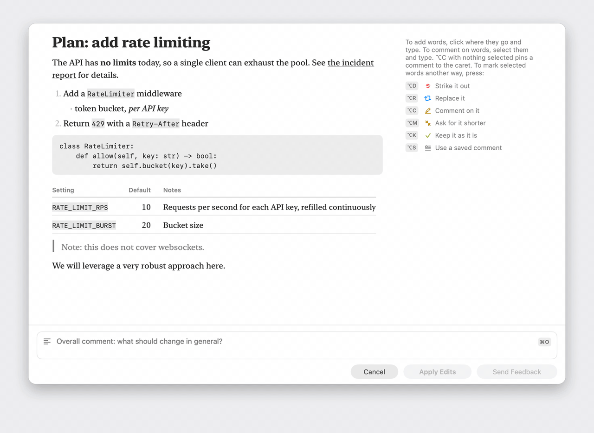

Callout is a native macOS menu-bar app for correcting text an AI wrote. You strike out, replace, insert, comment and mark what is good. The result goes back to the AI as feedback, or to you as the corrected text.



It has two parts:

- **The app** shows the text or PDF, lets you mark it up, and returns the result.
- **A Claude Code plugin** hands plans, replies and generated documents to the app, and returns your feedback to Claude.

Status: early development, with everything a first version needs. You can review text and PDFs from Claude Code (plans and what changed between their versions, replies, generated documents) and from any other app (a hotkey, the Services menu, drag and drop, the Share menu). Callout also keeps saved comments and a searchable history. It works in light and dark mode, with VoiceOver, Reduce Motion and Increase Contrast.

## Building

Requirements: macOS 14 or later, Apple silicon.

### Without Xcode

The Xcode Command Line Tools are enough to build, test and run a development copy of the app (`xcode-select --install`).

```sh
cd Packages/CalloutKit
swift test
swift run CalloutApp --review path/to/some.md
```

This runs the app without an app bundle. You get the menu-bar icon and the review window, but nothing that needs a bundle: no Services, no Share extension, and no stable identity for the Accessibility permission.

`swift build` also builds the command-line tool at `.build/debug/callout`. When the app isn't running, the tool starts the development app next to it.

Three environment variables make the tests do more. `CALLOUT_SNAPSHOT_DIR=<folder>` makes them write a picture of every window, in light and in dark, and `scripts/screenshots.sh` uses that to redraw the screenshots on this page. `CALLOUT_DEMO_DIR=<folder>` makes one test replay a review and write the frames of the video at the top, and `scripts/make-demo.sh` turns them into `docs/demo.gif` and `docs/demo.mp4` with ffmpeg. `CALLOUT_CORPUS=<a Claude Code transcript, a .jsonl file>` makes them put every text in that transcript through the renderer and onto a page, so the tests check the app against real replies as well as sentences written for a test.

### With Xcode

To build the real app bundle, [XcodeGen](https://github.com/yonaskolb/XcodeGen) generates an Xcode project from `project.yml`.

```sh
brew install xcodegen
scripts/run.sh docs/sample-plan.md
```

That builds the app, launches it and opens a sample plan for review. `scripts/run.sh docs/sample-cv.pdf` opens a sample PDF instead. To keep a copy, `scripts/install.sh` builds a release copy into `/Applications`, where the Claude Code plugin finds it.

Callout lives in the menu bar. Its icon is a rounded square with lines of text, one of them struck out. If you open the app yourself, from Finder or Spotlight, it shows the History of your reviews. When Claude Code starts it, it opens nothing until there is something to review. While a window is open, Callout also has a Dock icon, its own menu bar and a place in the `⌘Tab` switcher, so you can switch to the window like any other.

Both scripts sign with your Apple Development certificate when the Mac has one. To make one, add your Apple ID in Xcode's Settings → Accounts, then choose Manage Certificates → + → Apple Development. With it, macOS keeps the Accessibility permission from one build to the next. Without it, the scripts sign ad hoc, and you have to allow each new build again.

`scripts/release.sh` builds the download, `build/release/Callout-<version>.dmg`. The app in it runs on Apple silicon and Intel. It is signed with a Developer ID certificate, notarized by Apple and stapled, so it opens without a warning on any Mac. The script needs that certificate (Manage Certificates → + → Developer ID Application, which takes the paid Apple Developer Program) and a `notarytool` keychain profile named `callout-notary`. If either is missing, it says how to make it.

To work on it in Xcode, run `xcodegen generate && open Callout.xcodeproj`, select your team under Signing & Capabilities, and run the `Callout` scheme (`⌘R`). To build it under your own name, change `me.fabiosouto` to a prefix you own, in `project.yml` (`bundleIdPrefix` and each `PRODUCT_BUNDLE_IDENTIFIER`) and in `CalloutPaths.bundleIdentifier`.

## Using it

**The first time** it opens, a short practice plan teaches the marks. You strike the filler, replace a word, question a claim, and hand it in to see what Claude would receive. Callout sends nothing and keeps nothing. *Practice Review* in the Help menu, or in Settings, shows it again.


The document is a page, and your notes go in its margin, beside the lines they refer to. Callout sets quotes and dashes as in print, but the text that goes back is exactly what was written.

**Just type.** With the caret in the text and nothing selected, typing adds words there, and `⌫` strikes out what is before the caret. Your words show in blue and what you struck shows in red. The document itself never changes. Every edit is a mark, so you can undo it, and Claude gets each one as a separate correction. Typing is for words. It doesn't restructure lists or tables. To leave a note on a spot without adding words, press `⌥C` there. A small yellow pin marks the spot, and the note goes in the margin. You don't press a key before you type. `⌥I` only puts the caret after a selection. (With vim keys on, `i` starts adding words, as in vim, and `c` pins a comment at the caret.)

Callout sets tables in columns. Long column names wrap above their figures, and numbers line up on the right. A table wider than the window is set smaller to fit. When the cells are long sentences, Callout shows each row cell by cell, each cell after the name of its column. You can mark every cell either way.

**Or select, then type to comment on it.** For the other marks, press ⌥ and a key, or use the bar that appears above the selection:

| Key | Mark |
|---|---|
| `⌥D` or `⌫` | Strike it out |
| `⌥R` | Replace it with what you type next |
| `⌥I` | Put the caret after the selection, ready to add words |
| typing, or `⌥C` | Comment on it. With nothing selected, `⌥C` pins a comment to the caret |
| `⌥M` | Summarize, to ask for it shorter |
| `⌥K` | Keep it as it is |
| `⌥S` | Comment with one of your saved comments |

Comments and strikes open a note in the margin with the keyboard already in it. Write the comment there, or the reason for a strike, which can stay empty. `↩` finishes the note and takes you back to the document. `⌫` strikes without stopping for a reason.

| Key | |
|---|---|
| `Tab`, `⇧Tab` | Next and previous mark |
| `↩` | Write in the selected mark's note |
| `⌥↩` | A line break in the words you are adding |
| `⌘⌫` | Remove the mark the caret is on |
| `⌘O` | Write the overall comment |
| `⌘Z`, `⇧⌘Z` | Undo and redo |
| `⌘↩` | Send feedback |
| `⌘⇧↩` | Apply edits, or approve when the request allows it |
| `Esc` | Cancel |

A PDF has no caret to type at. Select text and use the keys, and write replacements and additions in the margin, as a copy editor marks a proof. The page shows where each one goes. A replacement is struck out in blue, and an addition has a caret. Select a note and a line links it to its mark. `scripts/run.sh docs/sample-cv.pdf` opens a sample to try.

**Vim keys.** Turn on *Move with vim keys* in Settings to move through the document from the keyboard. `h` `j` `k` `l`, `w` `b` `e`, `0` `$`, `{` `}`, `gg` and `G` move the caret. `v` starts a selection and `V` takes the line. `i` and `a` start adding words, and `Esc` stops. `n` and `N` go to the next and previous mark. `u` undoes and `⌃R` redoes. With vim keys on, letters only type in insert mode. On a selection, the plain letters are the marks, as in vim (`d`, `r`, `c`…). At the caret, `c` pins a comment. Keep moves to `⇧K`, because a plain `k` moves up. `o` opens the overall comment, and `Esc` never cancels the review. In a PDF, `j` and `k` scroll, and you still select text with the mouse.

**Saved comments.** Some comments you write again and again, such as "Do it.", "Why? Explain the reason." or "Too complex, simplify." Press `⌥S` to pick one, on a selection or at the caret. Type to filter, or press its number. The ones for what you are reviewing (plans, documents, GitLab, blog) come first. Edit them in Settings.

**History.** Callout keeps every finished review: what you reviewed, each mark, and what went back. *History…* in the menu-bar menu shows them as a shelf of the pages you marked. You can search them by title, text, feedback and overall comment, and select one to see what went back. It all stays on this Mac, in `~/Library/Application Support/Callout/callout.sqlite`.


**Accessibility.** With VoiceOver, the *Marks* rotor goes from mark to mark and reads each one as what was done to which words ("Replaced: leverage, with: use"). VoiceOver also announces each mark you make or remove. Reduce Motion turns off the window's movements, and Increase Contrast makes the highlighter stronger. You can make every mark from the keyboard.

## From any app

Outside Claude Code, the result goes to the clipboard, ready to paste back. `⌘↩` copies the feedback, and `⌘⇧↩` copies the corrected text.

- **Shortcut.** Select text anywhere and press `⌥⌘A` (you can change it in Settings). Callout presses `⌘C` for you and then puts your clipboard back. That needs the Accessibility permission, and Callout shows you how to allow it the first time.
- **Services menu.** Choose *Annotate with Callout* on any selected text. It needs no permission.
- **Menu-bar icon.** Drop a `.md`, `.txt` or `.pdf` file on it.
- **Share menu.** In Finder and Preview, share a file to Callout. You may have to turn the extension on once in System Settings, under Extensions.

Callout cleans up text you select in a terminal (Terminal, iTerm2, Ghostty). It removes the frames and bullets that terminal interfaces draw, and joins lines that the window's edge broke. *Show as Copied* in the review window switches to the untouched text.

## The command-line tool

`callout` is how anything outside the app asks for a review. It talks to the app over a Unix socket in `~/Library/Application Support/Callout/`, starts the app if needed, and waits until you respond.

```sh
callout review plan.md                  # feedback, or the corrected text, on standard output
git log -1 --format=%B | callout review - --title "Commit message"
callout review draft.md --reply clipboard
callout result                          # print the last finished review again
```

If the tool can't reach the app, or the app quits in the middle of a review, the tool says so in one line and exits with status 0. Whatever called it carries on as if there had been no review.

`callout result` prints a finished review again. Give it the review's id, or `--session` for the latest review of a session, or nothing for the latest of all. Reviews finished before the app last started come from History, so quitting the app loses only cancelled reviews, which Callout doesn't keep.

The other exit statuses mean the caller got something wrong. 64 is a command line the tool can't understand, and the tool also prints its usage. 66 is a file that is missing, isn't text or is empty, or empty standard input. 77 means something kept the tool from the app, as the sandbox note below explains. `callout result` exits with 1 when there is no finished review to print. So does `callout install` when it leaves a settings file alone, because it can't edit the file safely or the file is read-only. If a settings file is a link, `callout install` edits the file it points to.

In the app bundle, the tool is at `Callout.app/Contents/Helpers/callout`.

**With Claude Code's sandbox on,** shell commands can't use Unix sockets, so a `callout review` or `callout last-reply` run from a sandboxed shell can't reach the app. The tool says so and exits with 77, and `/callout` or `review_document` show its message. Plan reviews still work, because hooks run outside the sandbox. To let the tool through while it stays sandboxed, run `scripts/allow-sandbox.py` once per Mac. It adds the tool's socket to your own Claude Code settings, which cover every project, and keeps a copy of the file as it was beside it. `--remove` takes the entry out again. This is what it writes to `~/.claude/settings.json`, with your home folder in the path:

```json
{
  "sandbox": {
    "network": {
      "allowUnixSockets": ["/Users/you/Library/Application Support/Callout/callout.sock"]
    }
  }
}
```

## The Claude Code plugin

The plugin is in `plugin/`, and this repository is its marketplace:

```
/plugin marketplace add fasouto/callout
/plugin install callout@callout
```

From a checkout, `claude plugin marketplace add /path/to/callout` adds it by folder instead, and Claude Code then reads the plugin straight from `plugin/`.

The plugin needs Callout.app in `/Applications` or `~/Applications`. To use a copy elsewhere, set `CALLOUT_CLI` to the path of its `callout` tool before you start Claude Code. For development, load the plugin straight from a checkout:

```sh
CALLOUT_CLI=$PWD/Packages/CalloutKit/.build/debug/callout claude --plugin-dir ./plugin
```

**Plans.** When Claude finishes a plan, the plan opens in Callout before Claude Code shows its own dialog in the terminal. *Send Feedback* (`⌘↩`) sends your marks back, and Claude revises the plan. *Approve* (`⌘⇧↩`) approves the plan and asks Claude Code to switch to accept-edits mode. `Esc` closes the window and leaves you with Claude Code's dialog. If the app is missing or quits, you get that dialog too.

**Known limitation.** Claude Code, up to 2.1.290 at least, ignores a hook's approval of a plan and shows its own dialog anyway ([issue 97656](https://github.com/anthropics/claude-code/issues/97656)). After you approve in Callout, you still press Enter in the terminal. Feedback is not affected. `python3 scripts/check-plan-hook.py` tells you how your Claude Code version behaves.

When Claude revises a plan, the review shows what changed since the version you last saw. New text is tinted, and removed text is struck in grey where it used to be. *Hide Changes* turns that off. Callout keeps the versions for each Claude Code session.


**Replies.** Type `/callout` to go through Claude's last reply. It opens in Callout at once, without a turn from Claude. After *Send Feedback*, your marks come back to the conversation as a message from the plugin, and Claude acts on them. It rewrites the reply where you corrected its wording, and it carries out or answers each comment that is an instruction or a question. Type `/callout 2` for the reply before the last, or `/callout 3` for the one before that. Claude's own notes about running a review don't count. Only you can start a reply review. Claude never opens one by itself. A review stays open as long as you need, through a plugin reload, and through a restart of Claude Code that resumes the same session (`claude --resume`). The feedback reaches the session that opened it once that session is idle.

**Documents.** When Claude has written something you will send to someone else (a CV, a cover letter, a proposal, a post), it opens the document in Callout with the plugin's `review_document` tool. If it generated a PDF, it opens the PDF. The tool returns as soon as the document is open, and Claude ends its turn. Your feedback, or the text you edited in place, comes back as a message, and Claude applies it to the source and regenerates the document. You can also just say "let me review it".

Plans don't use the tool. They go through the plugin's `PermissionRequest` hook. Without the plugin, `callout install` adds that hook to `~/.claude/settings.json`. It edits only that entry and keeps a backup. `callout uninstall` removes it.

## Layout

```
project.yml                 XcodeGen spec for the app bundle
ShareExtension/             the Share menu entry
scripts/                    run, install and release the app, allow it in the sandbox, draw the icon, banner, screenshots and demo video, check the plan hook
plugin/                     the Claude Code plugin; .claude-plugin/ makes this repo its marketplace
App/, CLI/                  entry points of the two Xcode targets
Packages/CalloutKit/        Swift package with everything else
  Sources/CalloutCore/      contract, marks, formatter, apply-edits, markdown source mapping
  Sources/CalloutIPC/       the socket protocol between the app and the tool
  Sources/CalloutStore/     the SQLite database: plan versions, history, saved comments (GRDB)
  Sources/ClaudeCodeAdapter/ everything specific to Claude Code: hook formats, settings.json
  Sources/CalloutCLIKit/    the command-line tool's commands
  Sources/CalloutUI/        the app: menu-bar item, review window, text view
  Sources/CalloutApp/       runs the app unbundled, for development without Xcode
  Sources/callout/          the command-line tool built by SwiftPM
```

## License

GPLv3. See [LICENSE](LICENSE).
